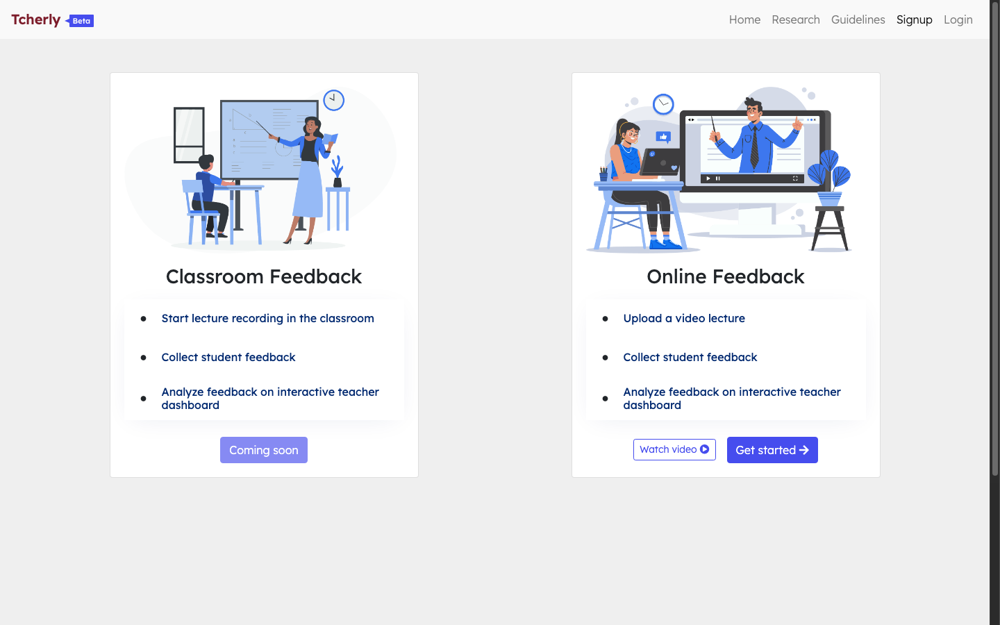
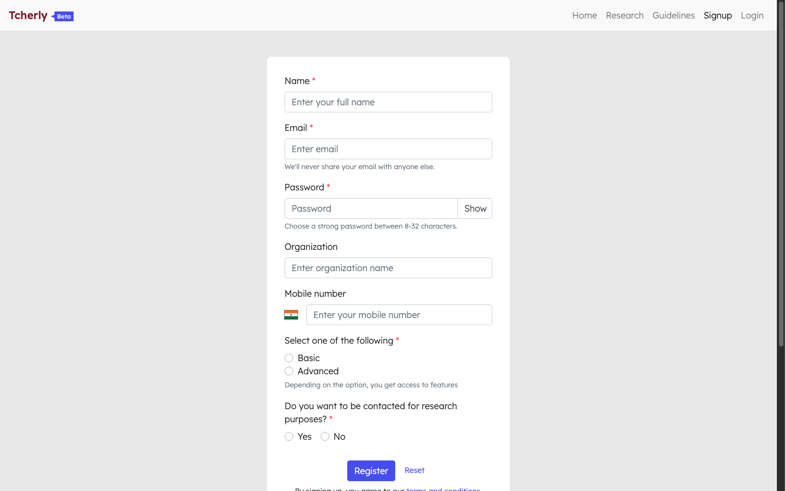

# Tcherly

> *Online student-feedback tool for improving lecture teaching practice.*

Tcherly (formerly **DEBE** — *Difficult, Easy, Boring, Engaging*) helps educators collect **high-resolution, in-lecture student feedback** and turn it into actionable pedagogical interventions. Developed from educational technology research at **IDP-ET, IIT Bombay**, Tcherly addresses the latency and coarseness of traditional end-of-semester surveys by providing real-time, minute-by-minute formative feedback during video lectures.

Live deployment: [https://www.tcherly.com](https://www.tcherly.com)

> **This repository adds Tcherly AI TeachMate** (G37 project): a conversational, reflective AI teaching assistant
> on top of Tcherly. See [TeachMate](#tcherly-ai-teachmate) below, and [HOW_TO_RUN.md](HOW_TO_RUN.md) to run it.

---

## Table of Contents

- [Tcherly AI TeachMate](#tcherly-ai-teachmate)
- [Overview & Core Loop](#overview--core-loop)
- [Tech Stack](#tech-stack)
- [Architecture & Diagrams](#architecture--diagrams)
- [Screenshots](#screenshots)
- [Installation & Setup](#installation--setup)
- [Available Commands](#available-commands)
- [Documentation](#documentation)
- [How this project was built](#how-this-project-was-built)

---

## Tcherly AI TeachMate

Tcherly shows *what* students felt minute by minute (Difficult, Easy, Boring, Engaging). Making sense of it still
takes a teacher's time and some data skills. TeachMate is an assistant beside the lesson dashboard that the teacher can
simply ask: *"Why did engagement drop?"*, *"What worked well?"*, *"What could I try in class?"* It follows Donald Schön's
*reflective practitioner* model: it reads the data, offers possible interpretations, asks the teacher reflective
questions and suggests options to adopt, adapt or reject. It never gives orders or verdicts.

| Feature | What the teacher gets |
| --- | --- |
| **Conversational assistant** | A chat drawer on the dashboard with suggested questions, live status ("Looking closely at min 17-23…") and streamed answers. Past chats are kept. |
| **Questions over the analytics** | Gemini calls 8 tools over the class data (overview, a time window, key moments, course comparison, viewing behaviour, bookmarks, strategies). Every number is cited as clickable evidence, e.g. **[E11]**. |
| **Grounding check** | Each cited number is checked against its evidence. A mismatch triggers one automatic correction, and the result is shown with the answer. |
| **Reflective prompts** | Answers end with questions for the teacher. When the teacher settles on an insight, TeachMate drafts a reflection card they can edit and save as a Tcherly bookmark. |
| **Viewing behaviour** | Where students re-watched, skipped ahead or stopped watching, linked to the feedback chart. |
| **Suggestions from research (RAG)** | A library of 24 cited teaching strategies (worked examples, peer instruction, retrieval practice, segmenting, …) and the teacher's own reflections from other lessons are retrieved with Gemini embeddings, so suggestions name the strategy and its source. |
| **Lesson reports** | One click produces a concise report: headline, key moments, what worked, the teacher's reflections, open questions and options with their research basis. Viewable in the browser and downloadable as a designed PDF. |
| **Evaluation** | A script tests 20 teacher questions, the reports and the grounding checker. See [teachmate/eval/README.md](teachmate/eval/README.md). |

```
React dashboard ──► TeachMate (Python, FastAPI) ──► Gemini (free tier, model fallback)
                         │
                         ├─► Tcherly Node API with the teacher's own login (ownership-checked)
                         ├─► strategy library (teachmate/knowledge)
                         └─► MongoDB (conversations, reports)
```

**Results** (2026-10-07 run, synthetic demo data): 19 of 20 answers fully grounded (318 numbers checked), 20 of 20
non-directive, 18 of 19 on-topic answers ask the teacher a reflective question, 3 of 3 reports grounded. The
evaluation also found 3 problems, fixed in the prompt; details in [teachmate/eval/README.md](teachmate/eval/README.md).

More: [teachmate/README.md](teachmate/README.md) (service, tools, API) ·
[documents/ARCHITECTURE.md](documents/ARCHITECTURE.md#teachmate-ai-reflective-teaching-assistant) (diagrams) ·
[DEMO_SCRIPT.md](DEMO_SCRIPT.md) (presentation walkthrough).

Only the synthetic demo data is sent to Gemini. Don't load real students' data on the free tier.

---

## Overview & Core Loop

```
Teacher creates Lesson (YouTube video)
        │
        ▼  Shares /l/<slug> link with students
Students watch video and submit real-time reactions at any timestamp:
        Difficult · Easy · Boring · Engaging  (+ optional sub-reasons)
        │
        ▼  Clicks stored with video timestamps
Teacher reviews Lesson Dashboard:
        Line charts · Venn diagrams · Radial charts · Participation · Detailed sub-reasons
        │
        ▼  Scrubs timeline to locate moments of difficulty or drop in engagement
Bookmark ──► Question ("Why did engagement drop at min 12?") ──► Action ("Add worked example")
        │
        ▼
Pedagogical intervention applied to future lectures
```

---

## Tech Stack

| Area | Technologies |
|---|---|
| **Backend** | Node.js, Express, Passport (Local & JWT), express-session, Handlebars (`hbs`) |
| **Frontend** | React 17 (Create React App in `client/`), React Router 5, Bootstrap 4 / react-bootstrap, Formik + Yup |
| **Database** | MongoDB via Mongoose 5, session store with connect-mongo |
| **Data Visualization** | Recharts, D3, `@upsetjs/venn.js`, Custom SVG radial heatmaps |
| **Integrations** | `react-player` (YouTube embed), `simple-youtube-api`, Mailgun, ExcelJS |
| **Tooling & Deploy** | Yarn, nodemon, concurrently, PM2 (`ecosystem.config.js`) |
| **TeachMate (AI)** | Python 3.10+, FastAPI + Uvicorn, Google Gemini via `google-genai` (function calling, streaming, `gemini-embedding-001`), PyMongo, PyJWT; pdfmake for report PDFs |

---

## Architecture & Diagrams

Comprehensive architectural specifications and system diagrams are documented in dedicated guides:

- **[System Architecture](documents/ARCHITECTURE.md)** — High-level system context diagram, authenticated request flows, and feedback analysis pipeline overview.
- **[Data Flow Diagrams](documents/DATA_FLOW.md)** — Detailed sequence and flow diagrams covering student feedback capture (write path), teacher dashboard rendering (read path), pipeline internals, three-identity auth model, and Excel export.
- **[Entity Relationship Diagram](documents/ER_DIAGRAM.md)** — Complete Mongoose schema relationships across all 13 models (`User`, `Student`, `Researcher`, `Course`, `Lesson`, `Feedback`, `Bookmark`, `Log`, etc.).

---

## Screenshots

> Captured from the live platform at [tcherly.com](https://www.tcherly.com).

### 1. Landing Page

*Home: Product introduction and "Get Started" entry into signup.*

### 2. Teacher Login

*Teacher authentication with email/password and password recovery.*

### 3. Registration Mode Selection

*Registration selection: Classroom Feedback (upcoming) or Online Feedback.*

### 4. Online Feedback Registration

*Signup form capturing institution, mode, feature tier, and research consent.*

### 5. Research Background

*Background: Pedagogical context and problem statement for in-lecture formative feedback.*

---

## Installation & Setup

> **Team members / first time here?** Follow **[HOW_TO_RUN.md](HOW_TO_RUN.md)**: a step-by-step guide from the zip file to a running project, including the TeachMate AI assistant. In short: install Node.js, Python and MongoDB → `npm run setup` → add your Gemini key to `.env` → `npm run dev` → open http://localhost:8080.

### Prerequisites

Ensure you have the following installed:

1. **[Node.js](https://nodejs.org/)**:
   - Recommended: Node.js `v14.x` or `v16.x` LTS.
   - *Node 17+ note*: React Scripts 4.0.1 (Webpack 4) requires the legacy OpenSSL provider. If using Node 17+, run `export NODE_OPTIONS=--openssl-legacy-provider`.
2. **[Yarn](https://classic.yarnpkg.com/en/docs/install/)** (v1.x):
   ```bash
   npm install --global yarn
   ```
3. **[MongoDB](https://www.mongodb.com/)** (v4.4+) running locally (`mongodb://localhost:27017/debe` in `.env.example`, falling back to `mongodb://localhost:27017/test-debe`) or via a remote connection string.

### Step-by-step Setup

1. **Clone the repository:**
   ```bash
   # Via SSH:
   git clone git@github.com:IITB-EdTech/tcherly.git
   cd tcherly

   # Or via HTTPS:
   git clone https://github.com/IITB-EdTech/tcherly.git
   cd tcherly
   ```

2. **Install server and client dependencies:**
   ```bash
   yarn
   yarn install:c
   ```

3. **Configure environment variables:**
   - Copy root backend `.env`:
     ```bash
     cp .env.example .env
     ```
   - Copy client `.env`:
     ```bash
     cp client/.env.example client/.env
     ```
   - Review and update MongoDB URI, token secrets, and optional YouTube/Mailgun keys (see [ENVIRONMENT.md](documents/ENVIRONMENT.md)).

4. **Start the development servers:**
   ```bash
   yarn dev
   ```
   - Frontend UI: [http://localhost:8080](http://localhost:8080)
   - Backend API: [http://localhost:3000](http://localhost:3000)

For comprehensive setup options, production deployment, troubleshooting, and CLI researcher seeding, see [INSTALLATION.md](documents/INSTALLATION.md).

---

## Available Commands

| Command | Description | Notes |
|---|---|---|
| `yarn dev` | Starts both server and client development servers concurrently | Backend: `http://localhost:3000`, Client: `http://localhost:8080` |
| `yarn dev:s` | Starts backend development server with `nodemon` | Restarts automatically on file changes |
| `yarn dev:c` | Starts frontend React dev server | Create React App development server |
| `yarn install:c` | Installs client-specific dependencies in `client/` | Shortcut for `cd client && yarn` |
| `yarn build` | Builds the React frontend for production | Outputs static bundle to `client/build` |
| `yarn serve` | Builds the client and starts the production server | Sets `NODE_ENV=production` |
| `yarn deploy` | Deploys using PM2 | Uses `ecosystem.config.js` |
| `yarn generate` | Seeds researcher accounts via CLI | Run `yarn generate --help` for usage |
| `npm run setup` | One-command setup: checks tools, installs everything, creates `.env`, loads the demo data | See [HOW_TO_RUN.md](HOW_TO_RUN.md) |
| `npm run dev` | Starts the server, the website and TeachMate together | TeachMate: `http://localhost:8000` (docs at `/docs`) |
| `npm run dev:ai` | Starts only TeachMate | Needs `GEMINI_API_KEY` in `.env` |
| `npm run seed` | Resets the demo course, students, feedback and viewing logs | Demo teacher: `demo.teacher@tcherly.local` / `Demo@1234` |
| `teachmate/.venv/Scripts/python teachmate/eval/run_eval.py --judge --reports` | Runs the TeachMate evaluation | macOS/Linux: `teachmate/.venv/bin/python` |

---

## Documentation

- **[INSTALLATION.md](documents/INSTALLATION.md)** — Detailed setup prerequisites and instructions.
- **[DEPLOYMENT.md](documents/DEPLOYMENT.md)** — Production deployment guide with PM2, Nginx, and SSL setup.
- **[ENVIRONMENT.md](documents/ENVIRONMENT.md)** — Comprehensive environment variable configuration reference.
- **[OVERVIEW.md](documents/OVERVIEW.md)** — Deep-dive system architecture, actors, feature map, and pipeline mechanics.
- **[ARCHITECTURE.md](documents/ARCHITECTURE.md)** — Mermaid diagrams of system context and analysis pipeline.
- **[DATA_FLOW.md](documents/DATA_FLOW.md)** — In-depth sequence and flow diagrams for data transactions.
- **[ER_DIAGRAM.md](documents/ER_DIAGRAM.md)** — Database schema and entity relationships.
- **[FEEDBACK.md](documents/FEEDBACK.md)** — Notes on feedback classification and interaction models.
- **[NOTES.md](documents/NOTES.md)** — Developer notes and system logs reference.
- **[LIST.md](documents/LIST.md)** — Project checklist and feature items.
- **[HOW_TO_RUN.md](HOW_TO_RUN.md)** — Step-by-step guide for teammates, from the zip file to a running project.
- **[teachmate/README.md](teachmate/README.md)** — The TeachMate service: tools, API, setup, knowledge library.
- **[teachmate/eval/README.md](teachmate/eval/README.md)** — Evaluation method, results, findings and limitations.
- **[DEMO_SCRIPT.md](DEMO_SCRIPT.md)** — A timed walkthrough for presenting TeachMate.

---

## How this project was built

Tcherly is the existing platform from IDP-ET, IIT Bombay (Chavan & Mitra, *Journal of Learning Analytics*, 2022).
TeachMate is the G37 group's addition on top of it. The group defined the objectives, made the design decisions,
tested the system and reviewed the results. **Claude** (Anthropic's AI coding assistant, used through Claude Code)
wrote most of the TeachMate code, the setup scripts and the documentation under the group's direction. At runtime,
TeachMate uses **Google Gemini** to generate its answers.