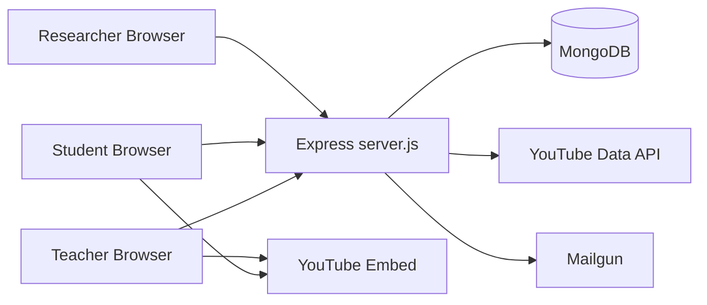
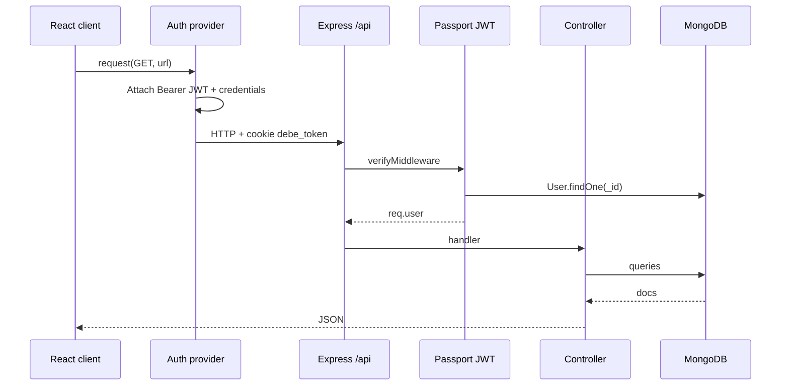
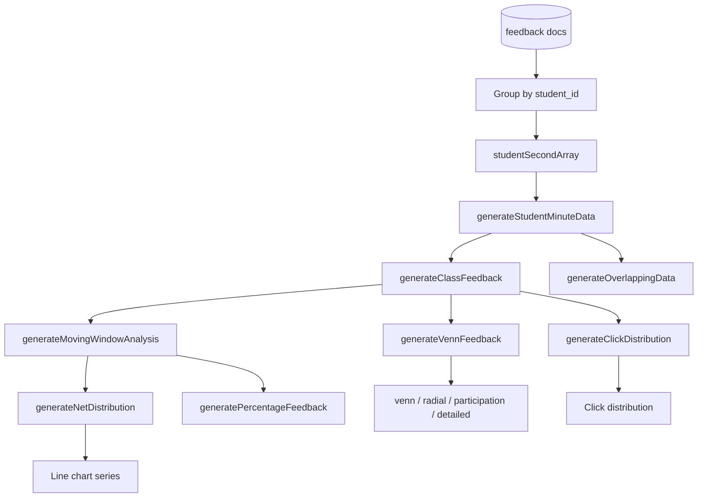
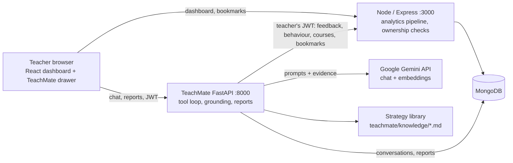
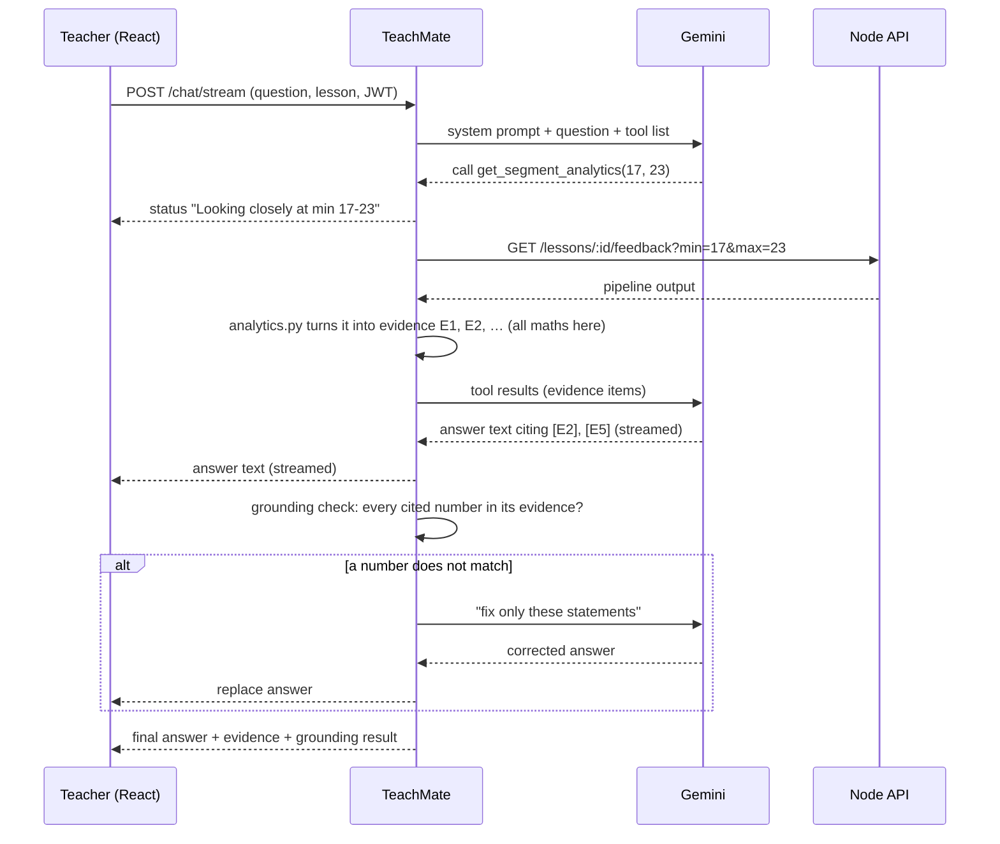
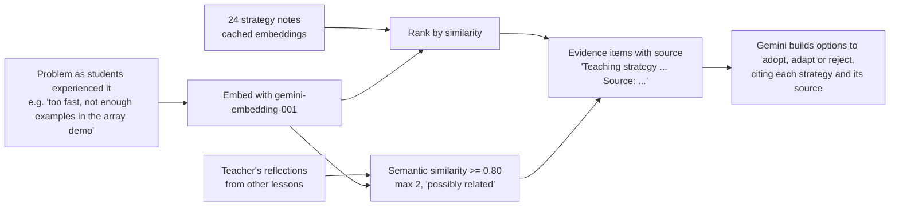
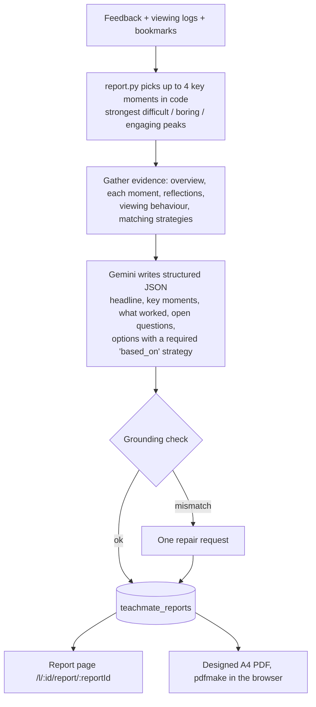

# Architecture Diagrams

## System context

## Request path (authenticated teacher)

## Feedback analysis pipeline

---

# TeachMate (AI reflective teaching assistant)

TeachMate is a separate Python service next to the Node app. It never reads MongoDB's feedback directly: it calls
the Node API with the teacher's own login token, so Tcherly's ownership checks apply to everything the AI sees.

## System context with TeachMate

## One chat question

## Retrieval (RAG) for suggestions

If the embedding API is unavailable, both rankings fall back to keyword matching.

## Lesson report

